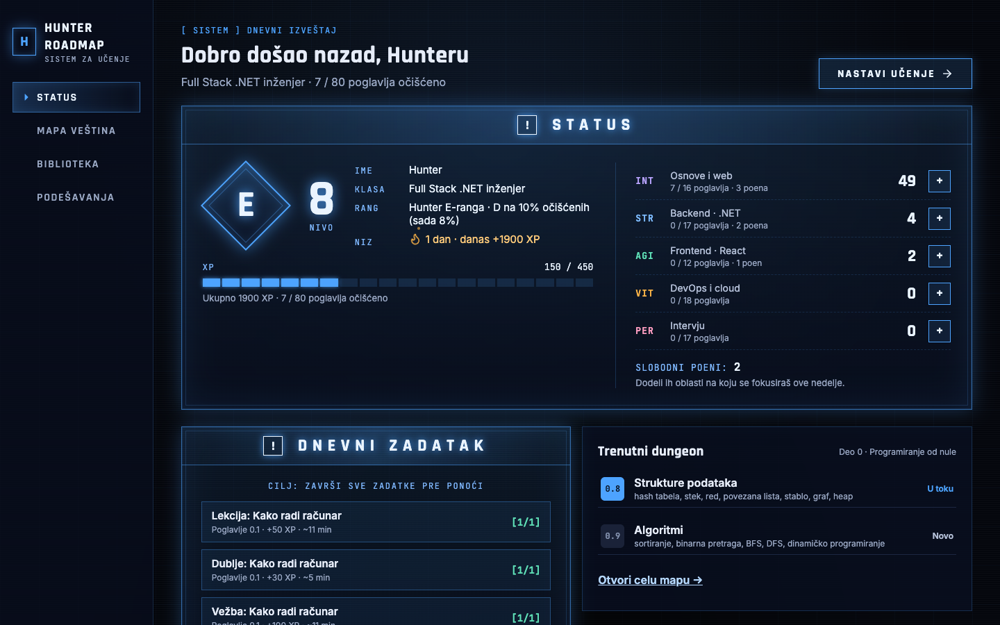
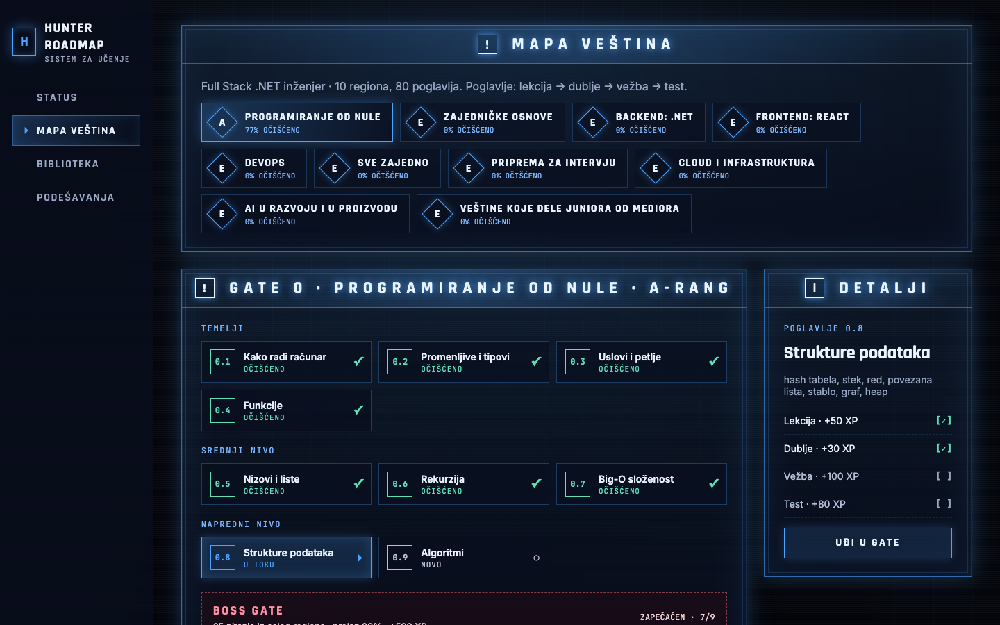
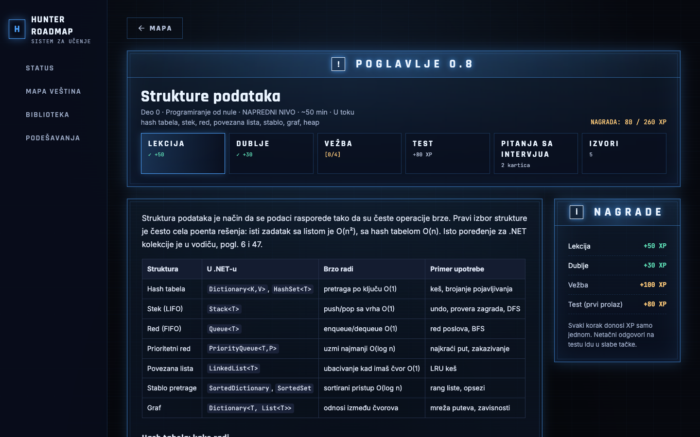
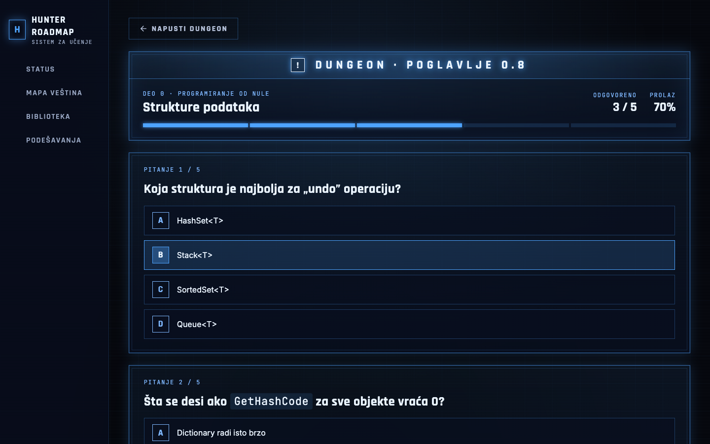

# Hunter Roadmap

[English](README.md) · **Srpski**

Lokalna aplikacija za učenje kao RPG sistem napretka: rangovi E→S, nivoi i XP, niz dana, mapa veština, dnevni i kazneni zadatak i boss test po regionu. Izgled „sistem prozora” je inspirisan žanrom progression fantasy animea; dizajn i elementi su originalni.

Univerzalna je: sadržaj dolazi iz **paketa** (otvoren JSON format `hunter-pack/1`), pa ista aplikacija radi za Full Stack, cybersecurity, nemački ili filozofiju. Uz nju ide paket za pripremu intervjua za full stack .NET: 80 poglavlja, 395 pitanja i 310 kartica sa intervjua, provereno prema zvaničnoj dokumentaciji (Microsoft Learn, MDN, react.dev, PostgreSQL, OWASP).

| Status | Mapa veština |
|---|---|
|  |  |
| **Poglavlje** | **Test („dungeon”)** |
|  |  |

Stack: **ASP.NET Core 10** (minimal API, EF Core, PostgreSQL) · **React 19 + TypeScript 7 + Vite 8** (TanStack Query, React Router) · **Docker Compose** · xUnit, Testcontainers, Vitest, Playwright.

## Šta radi

- **Status:** nivo, XP traka, rang, niz dana, statistike (po jedna za oblast paketa) i slobodni poeni.
- **Mapa veština:** regioni kao gate-ovi sa svojim rangom i % očišćenog; poglavlja ✓ očišćeno / ▸ u toku / ○ novo.
- **Poglavlje:** lekcija, „Dublje”, vežba kao čeklista, kartice sa intervjua i izvori; svaki korak daje XP jednom.
- **Test:** opcije se mešaju pri svakom pokušaju, ocenjuje server, tačni odgovori ne stižu u browser pre predaje. Netačna pitanja idu u „Slabe tačke”.
- **Dnevni zadatak:** 3–4 zadatka iz sledećih koraka, po dnevnom cilju u minutima; nagrada je slobodan poen.
- **Kazneni zadatak:** ako jučerašnji dnevni zadatak nije završen, prvo ide ponavljanje slabih tačaka; preskakanje prekida niz. Može da se isključi.
- **Boss test:** kad je region očišćen, 20–25 nasumičnih pitanja iz celog regiona, prolaz 80%, +500 XP.
- **Biblioteka:** upload paketa kao `.zip`, provera pre uvoza sa greškama po polju, izbor aktivnog paketa.
- **Podešavanja:** 4 teme (sistem, monarh, crveni, zlatni), sjaj, scan linije, smanjeni pokreti, dnevni cilj.
- **Pristupačnost:** prava dugmad i linkovi, ARIA za tabove, prekidače i dijaloge, vidljiv fokus, dodirne površine 44 px, kontrast ≥ 4,5:1; uz `prefers-reduced-motion` svaka animacija postaje kratak fade.

## Pokretanje

Potrebno je samo Docker Desktop (ili Docker na Linuxu).

```bash
cp .env.example .env          # opciono, za drugu lozinku baze
docker compose up --build
```

Otvori **http://localhost:8088**. Pri prvom pokretanju API napravi bazu (migracije) i uveze sve pakete iz `packs/`. Full Stack paket postaje aktivan.

Ako promeniš `POSTGRES_PASSWORD` posle prvog pokretanja, obriši volumen (`docker compose down -v`), jer je baza već napravljena sa starom lozinkom.

### Migracije baze

Šema se pravi i menja kroz EF Core migracije (`api/src/Hunter.Api/Data/Migrations`); API ih primeni sam pri pokretanju.

**Baza napravljena pre migracija** (faza 1, `EnsureCreated`) nema tabelu `__EFMigrationsHistory`, pa bi API pokušao da ponovo napravi postojeće tabele i pao. Obriši je jednom (napredak se gubi): `docker compose down -v`, pa `docker compose up --build`.

Nova migracija posle izmene modela (`dotnet tool install -g dotnet-ef` ako alat nemaš):

```bash
cd api && dotnet ef migrations add ImeIzmene --project src/Hunter.Api --output-dir Data/Migrations
```

## Razvoj

```bash
tools/dev.sh        # baza u Dockeru (localhost:5433) + dotnet watch (:8080) + Vite (http://localhost:5173)
```

- React izmene se vide odmah (Vite HMR), C# izmene posle par sekundi (`dotnet watch` sam restartuje API).
- Ctrl+C gasi API i web; baza ostaje da radi. Napredak je isti kao u Docker verziji (isti volumen).
- Baza je na **5433**, ne 5432, jer na 5432 često radi lokalno instaliran PostgreSQL.
- Isto, ručno u tri terminala:

```bash
docker compose -f docker-compose.yml -f docker-compose.dev.yml up -d db
cd api/src/Hunter.Api && dotnet watch     # Properties/launchSettings.json: Development, :8080
cd web && npm run dev                     # /api ide na :8080
```

U VS Code-u instaliraj predloženo proširenje „TypeScript Native Preview” (TypeScript 7 nema stari jezički servis).

## Testovi

| Nivo | Alat | Šta |
|---|---|---|
| jedinični | xUnit (53) | sva pravila igre u `Hunter.Core` |
| integracioni | `WebApplicationFactory<Program>` + Testcontainers PostgreSQL (32) | uvoz i aktivacija paketa, odbijen neispravan zip, XP samo jednom, odgovori skriveni pre predaje, test, dnevni i kazneni zadatak, slobodni poeni, boss |
| frontend | Vitest (17) | mešanje opcija, odbrojavanje, vremena boot ekrana, inline kod u pitanjima |
| E2E | Playwright u pravom Chrome-u (15) | koraci i +XP, level up, kapija pred test, dnevni zadatak, kazna, boss i „DUNGEON CLEARED”, smanjeni pokreti |

```bash
cd api && dotnet test       # Core + integracioni (traže pokrenut Docker)
cd web && npm run build && npm test
tools/e2e.sh                # E2E nad svežom instancom na :8099
```

`tools/e2e.sh` podiže poseban compose projekat (`hunter-e2e`, port 8099, sopstvena baza), pa glavna aplikacija na 8088 i njen napredak ostaju netaknuti. Koristi instalirani Chrome (`channel: "chrome"`). Praćenje uživo:

```bash
SLOWMO=1000 tools/e2e.sh --headed  # vidljiv Chrome, svaka radnja usporena 1 s
tools/e2e.sh --ui                  # Playwright UI: lista testova, koraci, snimak ekrana po koraku
tools/e2e.sh --debug               # Inspector: korak po korak
```

## Struktura

```
api/
  src/Hunter.Core/          pravila igre i format paketa (čitanje, provera); bez zavisnosti
  src/Hunter.Api/           minimal API: Endpoints.cs, Contracts.cs, Services/, Data/ (EF Core, migracije)
  tests/Hunter.Core.Tests/  xUnit testovi pravila
  tests/Hunter.Api.Tests/   integracioni testovi (WebApplicationFactory + Testcontainers)
web/
  src/pages/                Status, Mapa, Poglavlje, Test, Boss, Biblioteka, Podešavanja
  src/components/           prozor, poruka sistema, kazneni dijalog, efekti
  src/api.ts                tipovi i klijent (ugovor sa Contracts.cs)
  e2e/                      Playwright testovi
packs/                      paketi koji se uvoze pri pokretanju (jedan folder = jedan paket)
content/fullstack-dotnet/   izvorni Markdown za Full Stack paket
tools/                      sadržaj → paket, dev i E2E skripte
examples/                   primer paketa van IT-a (folder i .zip za upload)
```

Zašto dva projekta, a ne četiri sloja: pravila su odvojena u `Hunter.Core` i testiraju se bez baze, a sve ostalo je u jednom API projektu (endpoint → servis → `HunterDb`, bez MediatR-a i AutoMapper-a). To je „modularni monolit” iz vodiča (pogl. 1 i 13); kad aplikacija poraste, `Services/` se lako izdvoji u Application sloj.

## Format paketa (hunter-pack/1)

Paket je folder ili `.zip` sa dva fajla:

- **pack.json**: `id`, `title`, `description`, `version`, `passPct`, `xp`, `stats` (statistike, npr. INT = Osnove) i `regions` → `levels` → id-jevi poglavlja.
- **chapters.json**: lista poglavlja. Svako ima `id`, `title`, `minutes` i bar jedno od `lessonMarkdown` / `externalRef`. Opciono: `deeperMarkdown`, `exercise` (`steps`, `done`), `cards` (`q`, `a`), `test` (`text`, `code`, `options`, `correct`, `why`) i `sources`.

Najlakše je da kopiraš `examples/primer-filozofija` i menjaš ga. Uvoz je kroz **Biblioteka → Izaberi .zip** ili stavljanjem foldera u `packs/` i restartom API-ja.
Paket se proverava pre upisa (`PackValidator.cs`): nepostojeća statistika, poglavlje van strukture, `correct` van opsega, izvor bez linka… Greške se prikazuju u Biblioteci.
Nova verzija istog paketa zamenjuje sadržaj, a napredak ostaje jer je vezan za id paketa i id poglavlja.

Full Stack paket se pravi iz Markdown-a:

```bash
tools/build_pack.sh fullstack-dotnet    # content/fullstack-dotnet/src → packs/fullstack-dotnet
```

## Pravila igre

- **XP:** lekcija 50, dublje 30, vežba 100, test 80 (prvi prolaz), boss 500. Ponovljen korak ne daje XP (jedinstven indeks u bazi).
- **XP je događaj:** ukupan XP, nivo i niz dana se računaju iz događaja (`XpEvent`), ne čuvaju se kao broj.
- **Nivo:** iz ukupnog XP-a; sa nivoa N na N+1 treba 100 + 50·(N−1) XP.
- **Rang:** iz procenta očišćenih poglavlja aktivnog paketa: D 10%, C 25%, B 45%, A 65%, S 85%. Ne zavisi od XP-a, jer se XP može „farmovati”.
- **Niz dana:** uzastopni dani sa bar jednim osvojenim XP-om, po vremenu `Hunter:TimeZone` (Europe/Belgrade).
- **Test:** opcije se mešaju pri svakom pokušaju. Tačni odgovori ne napuštaju server pre predaje. Netačna pitanja idu u „Slabe tačke”.

## Plan

- ✅ Faza 1: osnovna aplikacija (status, mapa, poglavlja, testovi, biblioteka, podešavanja)
- ✅ Faza 2: migracije, integracioni i E2E testovi, dnevni i kazneni zadatak, slobodni poeni, boss test, animacije, boot ekran
- 🔄 Faza 3: novi izgled „Sistem 2.0” (gotov), pa nalozi (ASP.NET Core Identity, kolačić, podaci po korisniku kroz global query filter), Intervju arena sa ponavljanjem (Leitner 1/3/7/14 dana), simulacija intervjua
- ⬜ Faza 4: GitHub Actions i deploy na VPS iza HTTPS-a

**Poznato ograničenje:** jedan korisnik, bez prijave (lokalna aplikacija), pa upload paketa još nema antiforgery zaštitu; oboje dolazi sa nalozima u fazi 3.
